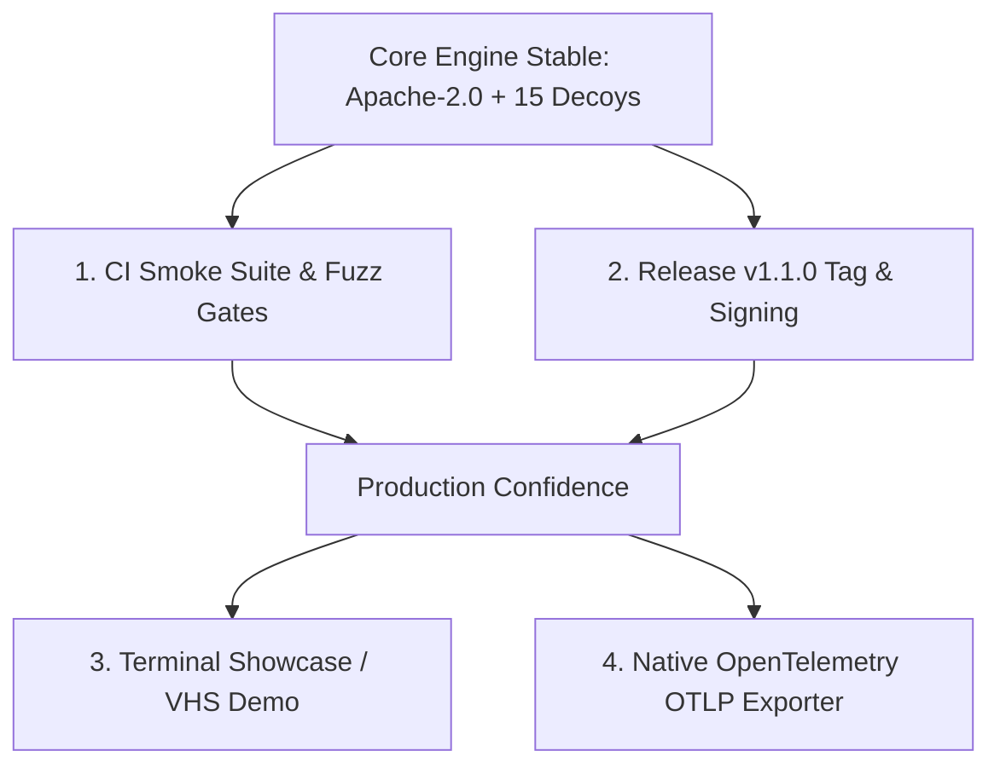
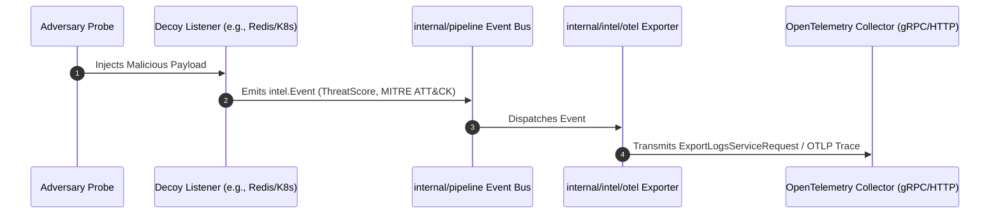

# Shinkiro — Pending Technical Initiatives & Strategic Roadmap

**Document Type:** Architectural Roadmap & Engineering Specifications  
**Target Platform:** Linux (amd64, arm64) / Go 1.24+  
**Scope:** `github.com/Haiagari/shinkiro`  
**Revision:** 1.0 — Production Ready  

---

## Table of Contents
1. [Overview & Strategic Context](#1-overview--strategic-context)
2. [Initiative 1: CI Pipeline Hardening & Deception Smoke Suite](#2-initiative-1-ci-pipeline-hardening--deception-smoke-suite)
3. [Initiative 2: Release v1.1.0 & Supply Chain Attestation](#3-initiative-2-release-v110--supply-chain-attestation)
4. [Initiative 3: Interactive Terminal Showcase & Community Assets](#4-initiative-3-interactive-terminal-showcase--community-assets)
5. [Initiative 4: Native OpenTelemetry (OTel / OTLP) Telemetry Exporter](#5-initiative-4-native-opentelemetry-otel--otlp-telemetry-exporter)
6. [Prioritization & Dependency Matrix](#6-prioritization--dependency-matrix)
7. [Verification & Acceptance Criteria](#7-verification--acceptance-criteria)

---

## 1. Overview & Strategic Context

Following the relicensing to Apache-2.0, the stabilization of the 15 in-memory protocol decoys, thread-safe kernel filter synchronization, and comprehensive parser fuzzing, this document formalizes the pending engineering tasks required to elevate Shinkiro from a hardened prototype to an industry-standard deception mesh.



---

## 2. Initiative 1: CI Pipeline Hardening & Deception Smoke Suite

### 2.1 Problem Statement
Currently, `.github/workflows/ci.yml` only executes unit tests (`make test`), dependencies verification, and binary compilation. It does not run the end-to-end sandbox runner (`scripts/demo.sh`) or protocol parser fuzz targets. A breaking change in protocol handshakes or memory bounds could be merged without failing CI.

### 2.2 Technical Scope & Changes
- **Target File:** `.github/workflows/ci.yml`
- **Actions:**
  1. Add a dedicated job step to execute `./scripts/demo.sh` inside Ubuntu GitHub Actions runners.
  2. Add a bounded fuzz-testing step (`go test -fuzz=... -fuzztime=3s`) across the 7 critical fuzz targets (Redis, Postgres, Docker, SSH, Modbus, MQTT, SMB) to ensure no regressions cause panics under malformed traffic.

### 2.3 Proposed Workflow Step
```yaml
      - name: Execute End-to-End Deception Smoke Test
        run: ./scripts/demo.sh

      - name: Run Short Security Fuzz Battery (3s per target)
        run: |
          go test -fuzz=FuzzRedisDecoy -fuzztime=3s ./internal/decoys/redis
          go test -fuzz=FuzzPostgresDecoy -fuzztime=3s ./internal/decoys/postgres
          go test -fuzz=FuzzDockerDecoy -fuzztime=3s ./internal/decoys/docker
          go test -fuzz=FuzzVirtualFSExecute -fuzztime=3s ./internal/decoys/ssh
          go test -fuzz=FuzzModbusDecoy -fuzztime=3s ./internal/decoys/modbus
          go test -fuzz=FuzzMQTTDecoy -fuzztime=3s ./internal/decoys/mqtt
          go test -fuzz=FuzzSMBDecoy -fuzztime=3s ./internal/decoys/smb
```

---

## 3. Initiative 2: Release v1.1.0 & Supply Chain Attestation

### 3.1 Problem Statement
The current latest release on GitHub is `v1.0.0` (published under the legacy AGPL-3.0 license and lacking recent concurrency hardening and fuzz test targets). Releasing `v1.1.0` delivers signed binaries, SPDX/CycloneDX SBOMs, and verifies the automated release pipeline.

### 3.2 Pre-Release Checklist
- [ ] Working tree clean and synced with remote `origin/main`.
- [ ] All 15 decoys pass `go test -race ./...`.
- [ ] End-to-end demo passes 10/10 scenarios via `make demo`.
- [ ] `git tag -a v1.1.0 -m "release: v1.1.0 Apache-2.0 release with hardened decoys and demo suite"`
- [ ] `git push origin v1.1.0`
- [ ] Verify GitHub Action `.github/workflows/release.yml`:
  - Build `shinkiro-linux-amd64` and `shinkiro-linux-arm64`.
  - Syft SBOM generation (`shinkiro-sbom.spdx.json`, `shinkiro-sbom.cdx.json`).
  - Cosign signature bundle generation (`dist/checksums.bundle`).

---

## 4. Initiative 3: Interactive Terminal Showcase & Community Assets

### 4.1 Problem Statement
Prospective users and security engineers need to see the interactive Bubbletea TUI and deception telemetry before deploying. High-quality terminal recordings (GIF/SVG) embedded in `README.md` drive organic adoption and credibility.

### 4.2 Implementation Plan
- Install [Charmbracelet VHS](https://github.com/charmbracelet/vhs).
- Author `docs/assets/demo.tape`:
  ```tape
  Output docs/assets/shinkiro-demo.gif
  Set FontSize 14
  Set Width 1200
  Set Height 700
  Type "make demo"
  Enter
  Sleep 10s
  ```
- Embed generated GIF into the hero section of `README.md`.

---

## 5. Initiative 4: Native OpenTelemetry (OTel / OTLP) Telemetry Exporter

### 5.1 Architecture & Motivation
Currently, Shinkiro exports deception telemetry to Syslog, CEF, ECS, STIX 2.1, and Webhooks. Enterprise SOCs and observability stacks increasingly rely on the OpenTelemetry Collector (OTLP gRPC / HTTP) to ingest structured events directly into Grafana Tempo/Loki, Datadog, or Splunk.

### 5.2 Component Design


### 5.3 Implementation Specification
1. Add `internal/intel/otel/exporter.go` leveraging `go.opentelemetry.io/otel`.
2. Map `intel.Event` fields to semantic conventions:
   - `service.name`: `shinkiro`
   - `decoy.protocol`: e.g. `redis`, `docker`
   - `threat.score`: `0-100`
   - `mitre.technique`: e.g. `T1059.006`
   - `source.ip`: Remote IP address
3. Add configuration section to `config.yaml`:
   ```yaml
   telemetry:
     otlp:
       enabled: false
       endpoint: "localhost:4317"
       insecure: true
   ```

---

## 6. Prioritization & Dependency Matrix

| Priority | Initiative | Complexity | Impact | Dependencies |
|---|---|---|---|---|
| **P0** | **Initiative 1: CI Smoke Suite** | Low (0.5d) | High (Prevents regressions) | `scripts/demo.sh` (Ready) |
| **P0** | **Initiative 2: Release v1.1.0** | Low (0.5d) | Critical (Official distribution) | Initiative 1 passing |
| **P1** | **Initiative 3: Terminal Showcase** | Low (0.5d) | High (Adoption & awareness) | Release v1.1.0 |
| **P2** | **Initiative 4: OpenTelemetry OTLP** | Medium (2d) | High (Enterprise SOC fit) | `internal/pipeline` |

---

## 7. Verification & Acceptance Criteria

Every initiative requires explicit automated validation prior to closing:

```bash
# 1. CI & Smoke Test Verification
make test && make lint && make fuzz && make demo

# 2. Release Verification
git tag -v v1.1.0 || git describe --tags --exact-match

# 3. Telemetry Ingestion Verification (Once OTel lands)
./bin/shinkiro up --config test-otlp.yaml &
./bin/shinkiro simulate --host 127.0.0.1
# Verify records received on OTLP collector endpoint (port 4317)
```
